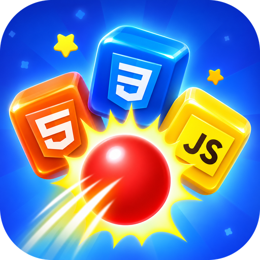

<div align="center">



# PBuster

**Bring down all the techs!**
A 2.5D shooting game where you make stacks of programming-language and framework cubes collapse, with a limited number of balls.

[**▶ Play online**](https://princess-buster.vercel.app/) · [**⬇ Download the APK**](https://github.com/princesse-aku/PBuster/releases/download/v0.1.0/PBuster-0.1.0-aarch64.apk) · [Install on mobile](#-install-on-mobile) · [Contribute](CONTRIBUTING.md)

[](https://github.com/princesse-aku/PBuster/actions/workflows/ci.yml)
[](LICENSE)


[](CONTRIBUTING.md)

[Français](README.md) · [English](README.en.md)

</div>

<p align="center">
  
</p>

<p align="center">
  
  
  
  
</p>

## The game

A stack of cubes (HTML, CSS, JavaScript, PHP, Laravel, Docker, ChatGPT, Claude…) sits on a table. Your fixed cannon at the bottom of the screen fires balls, and each ball **hits the targeted piece**:

- a **head-on** shot sends it **behind the table**;
- an **angled** shot **throws it sideways**;
- everything that rested on it loses its support and **collapses under gravity**, then the pieces **shatter into fragments** as they hit the ground.

You **win** when the table is empty and **lose** when you run out of balls while cubes remain. Levels get harder: heavier and bigger pieces, taller stacks, and on some levels a **hidden row behind** the front one.

## Play and install

- ▶️ **Online**: <https://princess-buster.vercel.app/> on phone, tablet and desktop.
- 📱 **<a id="-install-on-mobile"></a>Install on mobile (PWA)**: open the game in Chrome (Android) → ⋮ menu → **Install app**; on iPhone (Safari) → Share → **Add to Home Screen**. It then runs full screen like a native app, no APK needed.
- 🤖 **Android APK**: [PBuster-0.1.0-aarch64.apk](https://github.com/princesse-aku/PBuster/releases/download/v0.1.0/PBuster-0.1.0-aarch64.apk) (arm64 phones, from the [Releases](https://github.com/princesse-aku/PBuster/releases) page). Allow installation from your browser. Google sign-in is not available in the APK: use the online version or the PWA for the leaderboard.
- 💻 **Locally**: see [Quick start](#quick-start-developers).

On first launch: splash screen, terms, then **Sign in with Google** (to save your progress in the cloud and appear on the leaderboard) or **Play without an account**. You can sign in later from your profile.

## Features

- 🎯 **250 levels** in JSON files, **50 technologies** (including AI logos: ChatGPT, Claude, Gemini, Grok, Mistral…) unlocked step by step
- 🎨 **12 in-game backgrounds** that change from level to level
- 🏙️ **Illustrated home screen**: a full-screen futuristic city that adapts to every resolution, with the player's cup and a pile of cubes in the middle
- 💥 **Physical collapses**: pieces ejected sideways or backwards, chains of falls, colored fragments on the ground (Matter.js)
- 🔒 **No floating cubes**: every piece rests on another piece or on the table (checked by `npm test`)
- 🎁 **Power-ups**: **triple shot** (level 3) and **super ball** (level 10), one of each per level
- 👤 **Profiles**: 15 illustrated avatars, editable name; a default avatar is assigned at first sign-in
- ☁️ **Google sign-in, cloud progress and a global leaderboard** with Firebase / Firestore (optional)
- 🏆 **Leaderboard** with a podium, a top 10 and a full page, unlocked at level 5
- 📱 **Adaptive full screen** (portrait, landscape, tablet) and installable (PWA)
- ⚡ **Mobile-friendly**: cached background layers, capped canvas resolution that lowers itself automatically on slow devices
- 🔊 Music and sound effects synthesized with WebAudio (no audio files)
- 🧩 **Zero npm dependencies**: Node.js and a browser are enough (Matter.js is bundled)

## Progress, score and leaderboard

- **Technologies**: levels 1-5 only use **HTML5 and CSS3**. Every 5 levels one more technology is unlocked (JavaScript at level 6, PHP at level 11, then Sass, Bootstrap, TypeScript, … the AIs, … Dart). All **50** are unlocked by level 240.
- **Level score** (when won): **20 points + 1 point per remaining ball** (5 balls left = 25 points). A player's total is the sum of their best score per level.
- **Stars**: 1 to 3, depending on the share of balls saved.
- **Leaderboard** (from level 5): podium of the top 3, list down to 10th place, a **See more** button for the full list (up to 200 players), your rank highlighted. It needs Firebase; without it, it only shows players on the device.

## Quick start (developers)

Requires [Node.js](https://nodejs.org) **22.5+** (built-in `node:sqlite`).

```bash
git clone https://github.com/princesse-aku/PBuster.git
cd PBuster
npm start
```

Open <http://localhost:3000>.

```bash
npm test          # validates the 250 levels
npm run levels    # regenerates the levels (overwrites public/levels)
```

## Controls

| Action | Mouse / touch | Keyboard |
| --- | --- | --- |
| Aim | Drag | `←` `→` (or `A` `D`) |
| Fire | Release | `Space` or `Enter` |
| Power-up | Pick it on the level card | `1` (triple), `2` (super) |

## Levels

A level is a `public/levels/levelNNN.json` file (grid of `pieces` with `col/row/w/h/layer`, `balls`, `cubeWeight`, `theme`, `reward`…), produced by `tools/generate-levels.js`. Rules checked by `npm test`: no overlap in a row, everything inside the grid, and every piece rests on a piece of the same row or on the table. Details in [CONTRIBUTING.md](CONTRIBUTING.md) and, in French, in [README.md](README.md#créer-ou-modifier-un-niveau).

## How it works

The engine stays **2D** (Matter.js) for stacking and falling, and simulates **depth** with a per-piece `z` axis. Hits accumulate; once a piece has taken enough, it is **ejected** (backwards for a head-on shot, sideways for an angled one). What rested on it loses support and falls, and fallen pieces **shatter** at ground level. Each level's static background is drawn once into off-screen layers; only animated elements are redrawn every frame.

## Saving, accounts and Firebase

| Engine | When | Data |
| --- | --- | --- |
| **Firebase** (Google + Firestore) | `public/js/firebase-config.js` filled in | Cloud: progress, profile, global leaderboard |
| **SQLite** (local server API) | `npm start` | `data/princess-buster.db` |
| **Native SQLite** (Tauri) | Tauri app | Device database |
| **localStorage** | Fallback, guest mode without a server | Browser |

The public profile (name, avatar, scores) feeds the leaderboard; e-mail, statistics and settings stay in a **private** profile only the player can read. Security rules are in [`firestore.rules`](firestore.rules); the step-by-step setup (in French) is in [docs/FIREBASE.md](docs/FIREBASE.md). Scores are computed in the browser, so a determined player could still send fake results: strict anti-cheat would need server-side validation.

## Deployment

- **Vercel** (static site): [docs/DEPLOY-VERCEL.md](docs/DEPLOY-VERCEL.md), preset `Other`, root directory `./`.
- **Firebase**: [docs/FIREBASE.md](docs/FIREBASE.md).
- **Android / desktop** (optional): [docs/ANDROID.md](docs/ANDROID.md), built with Tauri. The PWA install is enough for most uses.

## Roadmap

- [ ] Desktop app with [Tauri](https://tauri.app)
- [ ] Special pieces (explosive, unbreakable, bouncy)
- [ ] Server-side score validation (Cloud Functions)
- [ ] Translations (the game is in French)
- [ ] Visual level editor

## Contributing

Contributions are welcome: bugs, levels, technologies, translations, accessibility, docs… Read the [contribution guide](CONTRIBUTING.md) and the [code of conduct](CODE_OF_CONDUCT.md). For a security issue, see [SECURITY.md](SECURITY.md).

## License and credits

- Code: [MIT license](LICENSE) © 2026 princesse-aku
- The **"PBuster" logo**, the **avatars** and the **home-screen illustration** are **not** covered by the MIT license: all rights reserved to the project author
- Technology logos: [Devicon](https://devicon.dev) (MIT) and AI logos: [Simple Icons](https://simpleicons.org) (CC0); the Grok logo is an original drawing evoking the brand; the PHP logo is the PHP project's. Trademarks belong to their respective owners
- Physics: [Matter.js](https://brm.io/matter-js/) (MIT)
- Gameplay inspiration: mobile cube-stack shooters. No asset from those games is used here
