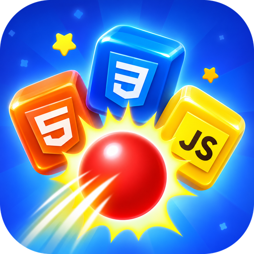

<div align="center">



# Princess Buster

**Fais tomber toutes les technos !**
Un jeu de tir en 2.5D où tu fais s'effondrer des piles de cubes de langages et de frameworks de programmation, avec un nombre de balles limité.

[**▶ Jouer en ligne**](https://princess-buster.vercel.app/) · [**⬇ Télécharger l'APK**](https://github.com/princesse-aku/princess_buster/releases/download/v0.1.0/PrincessBuster-0.1.0-aarch64.apk) · [Installer sur mobile](#-installer-sur-mobile) · [Contribuer](CONTRIBUTING.md)

[](https://github.com/princesse-aku/princess_buster/actions/workflows/ci.yml)
[](LICENSE)


[](CONTRIBUTING.md)

[Français](README.md) · [English](README.en.md)

</div>

<p align="center">
  
</p>

<p align="center">
  
  
  
  
</p>

## Sommaire

- [Le jeu](#le-jeu)
- [Jouer et installer](#jouer-et-installer)
- [Fonctionnalités](#fonctionnalités)
- [Progression, score et classement](#progression-score-et-classement)
- [Démarrage rapide (développeurs)](#démarrage-rapide-développeurs)
- [Contrôles](#contrôles)
- [Les 250 niveaux](#les-250-niveaux)
- [Créer ou modifier un niveau](#créer-ou-modifier-un-niveau)
- [Comment ça marche](#comment-ça-marche)
- [Sauvegarde, comptes et Firebase](#sauvegarde-comptes-et-firebase)
- [Architecture du projet](#architecture-du-projet)
- [Déploiement](#déploiement)
- [Raccourcis de développement](#raccourcis-de-développement)
- [Feuille de route](#feuille-de-route)
- [Contribuer](#contribuer)
- [Licence et crédits](#licence-et-crédits)

## Le jeu

Une pile de cubes (HTML, CSS, JavaScript, PHP, Laravel, Docker, ChatGPT, Claude…) est posée sur une table. Ton canon, fixe en bas de l'écran, tire des balles. Chaque balle **frappe la pièce visée** :

- un tir **de face** l'envoie **derrière la table** ;
- un tir **en angle** la **projette sur le côté** ;
- tout ce qui était posé dessus perd son appui et **s'effondre par gravité**, puis les pièces **se brisent en éclats** en tombant au sol.

Tu **gagnes** quand la table est vide, tu **perds** quand tu n'as plus de balles alors qu'il reste des cubes. Les niveaux se compliquent : pièces plus lourdes et plus grandes, piles plus hautes, et sur certains niveaux une **rangée cachée derrière** celle de devant (elle n'apparaît qu'une fois la rangée de devant tombée).

## Jouer et installer

- ▶️ **En ligne** : <https://princess-buster.vercel.app/>, sur téléphone, tablette et ordinateur.
- 📱 **<a id="-installer-sur-mobile"></a>Installer sur mobile (PWA)** : ouvre le jeu dans Chrome (Android) → menu ⋮ → **Installer l'application** ; sur iPhone (Safari) → Partager → **Sur l'écran d'accueil**. Le jeu s'ouvre alors en plein écran comme une vraie application, sans APK à télécharger.
- 🤖 **APK Android** : [PrincessBuster-0.1.0-aarch64.apk](https://github.com/princesse-aku/princess_buster/releases/download/v0.1.0/PrincessBuster-0.1.0-aarch64.apk) (téléphones arm64, depuis la page [Releases](https://github.com/princesse-aku/princess_buster/releases)). Autorise l'installation depuis ton navigateur. La connexion Google n'y est pas disponible : pour le classement, utilise la version en ligne ou la PWA.
- 💻 **En local** : voir [Démarrage rapide](#démarrage-rapide-développeurs).

Au premier lancement : écran de démarrage, conditions d'utilisation, puis **connexion avec Google** (pour sauvegarder ta progression dans le cloud et apparaître dans le classement) ou **« Jouer sans compte »**. Tu peux te connecter plus tard depuis ton profil.

## Fonctionnalités

- 🎯 **250 niveaux** décrits en JSON, **50 technologies** (dont les logos des IA : ChatGPT, Claude, Gemini, Grok, Mistral…) débloquées pas à pas
- 🎨 **12 décors de jeu** qui changent de niveau en niveau : prairie, nuit, coucher de soleil, neige, désert, océan, bonbons, forêt, espace, automne, volcan, néon
- 🏙️ **Accueil illustré** : une ville futuriste plein écran qui s'adapte à toutes les résolutions (portrait, paysage, tablette), avec la tasse du joueur et son tas de cubes au centre
- 🧱 **Pièces de formats variés** : carrés, rectangles larges ou hauts, 2×2, 3×1, 3×2
- 💥 **Effondrements physiques** : pièces éjectées sur le côté ou vers le fond, chaînes de chutes, éclats colorés au sol (moteur Matter.js)
- 🔒 **Aucun cube suspendu dans le vide** : chaque pièce repose sur une autre ou sur la table (vérifié par `npm test`)
- 🎁 **Bonus** : **tir triple** (dès le niveau 3) et **super balle** (dès le niveau 10), un de chaque par niveau
- 👤 **Profils** : 15 avatars illustrés, nom modifiable, statistiques ; un avatar par défaut est attribué à la première connexion
- ☁️ **Connexion Google, progression dans le cloud et classement général** avec Firebase / Firestore (optionnel)
- 🏆 **Classement** avec podium, top 10 et page complète, débloqué au niveau 5
- 📱 **Plein écran adaptatif** : téléphone, tablette, ordinateur, portrait ou paysage ; installable (PWA)
- 🔊 Musique de fond et bruitages synthétisés en WebAudio (aucun fichier audio), avec réglages son / musique / vibrations
- ⚡ **Optimisé pour le mobile** : décor mis en cache, résolution du canvas plafonnée et réduite automatiquement si l'appareil rame
- 🔎 **SEO et partage** : balises Open Graph / Twitter, données structurées, `robots.txt`, `sitemap.xml`, image de partage 1200×630
- 🧩 **0 dépendance npm** : Node.js et un navigateur suffisent (Matter.js est fourni dans `public/vendor/`)

## Progression, score et classement

- **Technologies** : les niveaux 1 à 5 n'utilisent que **HTML5 et CSS3**. À chaque palier de 5 niveaux, une nouvelle technologie est débloquée : JavaScript (niveau 6), PHP (niveau 11), puis Sass, Bootstrap, TypeScript, jQuery, Tailwind CSS, Laravel, Node.js, Express, React, Vue.js, Angular, Python, Django, MySQL, MongoDB, Docker, Git, les IA (ChatGPT, Claude, Gemini, Grok, Mistral AI, Perplexity, Hugging Face, GitHub Copilot, Ollama, Llama), puis Go, Rust, Kotlin, Swift, Java, C#, C++, Ruby, Flutter et Dart. Les **50** sont toutes débloquées au niveau 240 (Bash en dernier). Le **coffre** de l'accueil montre la prochaine technologie.
- **Score d'un niveau gagné** : **20 points + 1 point par balle restante** (5 balles restantes = 25 points). Le total d'un joueur est la somme de ses meilleurs scores par niveau.
- **Étoiles** : 1 à 3, selon la proportion de balles économisées.
- **Classement** (à partir du niveau 5) : podium des 3 premiers, liste jusqu'au 10ᵉ, bouton **Voir plus** vers la liste complète (jusqu'à 200 joueurs) et ton rang surligné. Il demande Firebase ; sans Firebase, il ne montre que les joueurs de l'appareil.

## Démarrage rapide (développeurs)

Prérequis : [Node.js](https://nodejs.org) **22.5 ou plus** (module `node:sqlite` intégré).

```bash
git clone https://github.com/princesse-aku/princess_buster.git
cd princess_buster
npm start
```

Ouvre <http://localhost:3000> (sur ton téléphone : `http://<ip-de-ton-pc>:3000`, même réseau Wi-Fi).

```bash
npm test          # valide les 250 niveaux (formats, techs, thèmes, aucun cube suspendu)
npm run levels    # régénère les niveaux (attention : écrase public/levels)
```

> Le serveur local crée `data/princess-buster.db` (ignoré par git). Sans serveur (hébergement statique), le jeu sauvegarde dans le navigateur (`localStorage`) ou dans Firebase si tu l'as configuré.

## Contrôles

| Action | Souris / tactile | Clavier |
| --- | --- | --- |
| Viser | Glisser (le réticule suit ton doigt) | `←` `→` (ou `A` `D`) |
| Tirer | Relâcher | `Espace` ou `Entrée` |
| Annuler un tir | Ramener le doigt vers le canon avant de relâcher | n/a |
| Bonus | Choisis-le sur la fiche du niveau | `1` (triple), `2` (super) |
| Plein écran | Bouton ⛶ | n/a |

## Les 250 niveaux

Les niveaux sont des fichiers `public/levels/levelNNN.json` produits par `tools/generate-levels.js` :

- piles de plus en plus grandes (jusqu'à 9×8), pièces plus lourdes et plus grandes ;
- une rangée cachée derrière celle de devant sur certains niveaux (à partir du niveau 9), jamais plus de 2 plans ;
- un décor différent à chaque niveau (rotation des 12 thèmes) ;
- un nombre de balles calculé d'après la difficulté de chaque niveau.

## Créer ou modifier un niveau

```json
{
  "id": 3,
  "name": "Niveau 3",
  "theme": "sunset",
  "block": 0,
  "reward": null,
  "balls": 15,
  "cubeWeight": 1.09,
  "techs": ["html5", "css3"],
  "rows": 3,
  "cols": 3,
  "pieces": [
    {"tech":"html5","col":0,"row":2,"w":2,"h":1,"layer":0},
    {"tech":"css3","col":2,"row":2,"w":1,"h":1,"layer":0},
    {"tech":"css3","col":0,"row":1,"w":1,"h":1,"layer":0},
    {"tech":"html5","col":0,"row":1,"w":1,"h":2,"layer":1}
  ]
}
```

| Champ | Rôle |
| --- | --- |
| `theme` | Décor du niveau (un des 12 thèmes) |
| `block` | Numéro du palier de 5 niveaux (0 = niveaux 1 à 5) |
| `reward` | Clé de la techno débloquée à la fin du niveau (5ᵉ de chaque palier), sinon `null` |
| `balls` | Nombre de balles disponibles |
| `cubeWeight` | Poids des pièces (plus c'est lourd, plus il faut de coups) |
| `rows` / `cols` | Taille de la grille (la ligne `0` est en haut) |
| `pieces[].col/row` | Coin supérieur gauche de la pièce |
| `pieces[].w/h` | Taille en cases (1×1, 2×1, 1×2, 2×2…) |
| `pieces[].layer` | `0` = devant, `1` = rangée cachée derrière |
| `pieces[].tech` | Clé d'une techno de `public/levels/index.json` |

**Règles** (vérifiées par `npm test`) : pas de chevauchement dans une même rangée, tout dans la grille, et chaque pièce repose sur une pièce de la même rangée ou sur la table. Détails dans [CONTRIBUTING.md](CONTRIBUTING.md#ajouter-ou-modifier-un-niveau).

## Comment ça marche

Le moteur reste en **2D** (Matter.js) pour l'empilement et les chutes, et simule la **profondeur** avec un axe `z` propre à chaque pièce.

1. Une balle touche la pièce la plus à l'avant sous le curseur et lui donne de l'élan, divisé par sa masse.
2. Les coups s'accumulent. Quand une pièce en a reçu assez, elle est **éjectée** : vers le fond (tir de face) ou sur le côté (tir en angle, vers le bord de table le plus proche).
3. Ce qui reposait sur elle perd son appui et tombe par gravité, entraînant ses voisines.
4. Les pièces tombées se **brisent en éclats** au niveau du sol. Le niveau est gagné quand il n'en reste aucune.

Côté affichage, le décor fixe de chaque niveau est dessiné une seule fois dans des calques hors écran et seuls les éléments animés sont redessinés à chaque image.

## Sauvegarde, comptes et Firebase

Quatre moteurs de sauvegarde, avec les mêmes données (`players` / `progress`), choisis automatiquement :

| Moteur | Quand | Données |
| --- | --- | --- |
| **Firebase** (Google + Firestore) | `public/js/firebase-config.js` renseigné | Cloud : progression, profil, classement général |
| **SQLite** (API du serveur local) | `npm start` | `data/princess-buster.db` |
| **SQLite natif** (Tauri) | Application Tauri | Base locale de l'appareil |
| **localStorage** | Repli, mode invité sans serveur | Navigateur |

- Avec Firebase, le profil public (nom, avatar, scores) alimente le classement ; l'e-mail, les statistiques et les réglages restent dans un profil **privé** que seul le joueur peut lire.
- Les règles de sécurité sont dans [`firestore.rules`](firestore.rules) et le pas-à-pas dans **[docs/FIREBASE.md](docs/FIREBASE.md)**.
- À la première connexion Google, la progression déjà jouée sur l'appareil (sans compte) est reprise dans le compte.
- Le score est calculé côté navigateur : les règles empêchent déjà de toucher aux données d'un autre joueur ou de baisser un score, mais un classement à l'épreuve de la triche demanderait une validation côté serveur (voir la section « Limites » de [docs/FIREBASE.md](docs/FIREBASE.md)).

API du serveur local :

| Méthode | Route | Rôle |
| --- | --- | --- |
| `POST` | `/api/player` | Crée ou retrouve un joueur `{ name }` et renvoie sa progression |
| `POST` | `/api/progress` | Enregistre un résultat `{ playerId, level, score, won }` |
| `GET` | `/api/leaderboard` | Top 10 des joueurs |

## Architecture du projet

```
princess_buster/
├── public/                    # le jeu (statique)
│   ├── index.html             # écrans, SEO, accueil
│   ├── css/                   # style.css, home.css, home2.css
│   ├── js/
│   │   ├── game.js            # moteur : physique Matter.js, profondeur, rendu canvas, canon, éclats
│   │   ├── ui.js              # écrans, navigation, entrées, classement, profil
│   │   ├── audio.js           # musique + bruitages synthétisés (WebAudio)
│   │   ├── storage.js         # sauvegarde : Firebase, SQLite, localStorage
│   │   └── firebase-config.js # configuration Firebase (null = désactivé)
│   ├── levels/                # index.json + level001..250.json
│   ├── assets/                # logo, avatars, podium, fond d'accueil, tech/*.svg (50 logos)
│   └── vendor/matter.min.js
├── server/server.js           # serveur local : fichiers statiques + API SQLite (node:sqlite)
├── tools/                     # generate-levels.js, validate-levels.js, build-android.ps1
├── src-tauri/                 # application Tauri (desktop / Android), optionnelle
├── firestore.rules            # règles de sécurité Firestore
├── docs/                      # FIREBASE.md, DEPLOY-VERCEL.md, ANDROID.md, captures, visuels promo
├── vercel.json                # déploiement statique (dossier public/)
└── .github/                   # CI, modèles d'issues et de pull requests
```

## Déploiement

- **Vercel** (site statique, déploiement à chaque `git push`) : [docs/DEPLOY-VERCEL.md](docs/DEPLOY-VERCEL.md). Réglages : *Framework Preset* `Other`, *Root Directory* `./`.
- **Firebase** : [docs/FIREBASE.md](docs/FIREBASE.md), à faire une fois (projet, connexion Google, Firestore, règles, configuration).
- **Android / desktop** (optionnel) : [docs/ANDROID.md](docs/ANDROID.md), compilation avec Tauri. L'installation PWA suffit pour la plupart des cas.

## Raccourcis de développement

```text
/?name=Ada                          → connexion directe en invité, accueil
/?name=Ada&screen=menu              → menu des niveaux
/?name=Ada&screen=profile           → ouvre le profil
/?name=Ada&level=12                 → lance directement le niveau 12
/?name=Ada&level=12&autoplay=1      → un petit robot joue (démo, captures)
/?name=Ada&level=12&autoplay=1&clean=1   → idem, sans bandeau ni texte d'aide
```

## Feuille de route

- [ ] Application **desktop avec [Tauri](https://tauri.app)** (`public/` est déjà le `frontendDist`)
- [ ] Pièces spéciales (explosives, indestructibles, rebondissantes)
- [ ] Validation des scores côté serveur (Cloud Functions) pour un classement à l'épreuve de la triche
- [ ] Traductions (le jeu est en français)
- [ ] Éditeur de niveaux visuel

Une idée ? Ouvre une [issue](https://github.com/princesse-aku/princess_buster/issues/new/choose).

## Contribuer

Les contributions sont les bienvenues : bugs, niveaux, technologies, traductions, accessibilité, documentation…
Lis le [guide de contribution](CONTRIBUTING.md) et le [code de conduite](CODE_OF_CONDUCT.md). Pour une faille de sécurité, voir [SECURITY.md](SECURITY.md).

## Licence et crédits

- Code : [licence MIT](LICENSE) © 2026 princesse-aku
- Le **logo « Princess Buster »**, les **avatars** et l'**illustration d'accueil** ne sont **pas** couverts par la licence MIT : tous droits réservés à l'auteur du projet
- Logos des technologies : [Devicon](https://devicon.dev) (MIT) et logos d'IA : [Simple Icons](https://simpleicons.org) (CC0) ; le logo de Grok est un dessin original évoquant la marque ; le logo de PHP est celui du projet PHP. Les marques appartiennent à leurs propriétaires respectifs
- Physique : [Matter.js](https://brm.io/matter-js/) (MIT)
- Inspiration de gameplay : les jeux de tir de cubes en piles pour mobile. Aucun asset de ces jeux n'est utilisé ici
